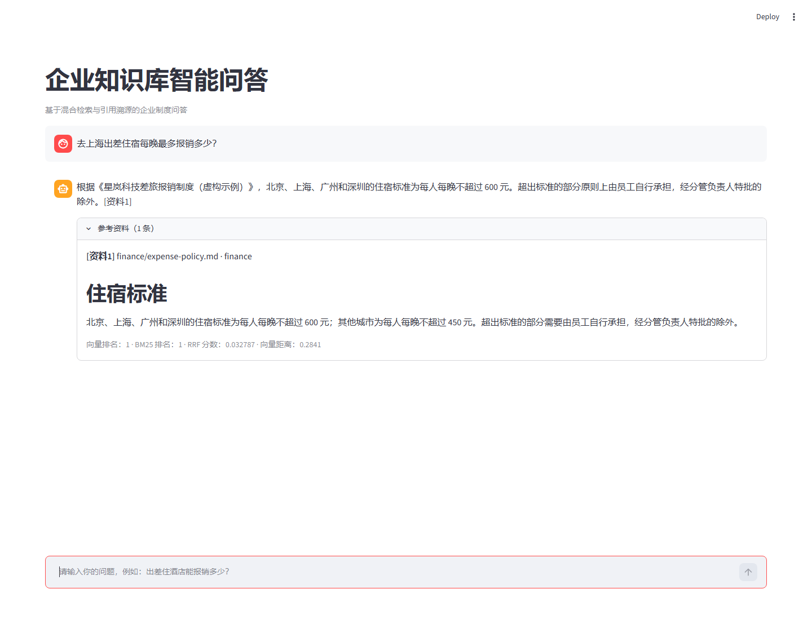
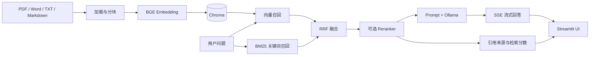

# Enterprise RAG Knowledge Q&A

面向企业制度文档的知识问答系统，覆盖文档入库、混合检索、可选重排、流式回答和引用溯源。仓库内的公司名称与制度内容均为公开演示用的虚构数据。




## 核心能力

- 支持 Markdown、TXT、PDF、DOCX 文档加载与递归分块。
- 使用 BGE 中文向量模型和 Chroma 完成语义召回。
- 使用 jieba + BM25 补充关键词召回，通过 RRF 融合两路排名。
- 可选接入 `bge-reranker-large` 做第二阶段重排。
- 通过 Ollama 调用本地大模型，支持普通响应和 SSE 流式响应。
- 回答强制基于检索上下文，并返回文件名、页码、分类和检索分数。
- 提供检索评测脚本，用 `Hit@K` 和 `MRR@K` 检查召回质量。

## 架构



## 技术栈

`Python` · `FastAPI` · `Streamlit` · `LangChain` · `Chroma` · `BGE` · `BM25` · `RRF` · `Ollama`

## 快速开始

要求 Python 3.12+，并安装 [Ollama](https://ollama.com/)。

```powershell
python -m venv .venv
.\.venv\Scripts\Activate.ps1
pip install -r requirements.txt
Copy-Item .env.example .env
ollama pull deepseek-r1:7b
python scripts\build_index.py
```

启动后端：

```powershell
uvicorn app.main:app --reload --port 8000
```

接口文档：`http://127.0.0.1:8000/docs`

另开终端启动前端：

```powershell
.\.venv\Scripts\Activate.ps1
streamlit run streamlit_app.py
```

聊天页面：`http://127.0.0.1:8501`

## 使用私有知识库

将自己的文件放入独立目录，然后重新建库：

```powershell
python scripts\build_index.py --docs-dir C:\path\to\documents
```

支持 `.md`、`.txt`、`.pdf`、`.docx`。原始文档和 `data/chroma/` 默认不会进入 Git。

如需完全离线运行，将 `.env` 中的模型改为本地路径：

```dotenv
RAG_EMBEDDING_MODEL=C:\path\to\bge-large-zh-v1.5
RAG_ENABLE_RERANK=true
RAG_RERANKER_MODEL=C:\path\to\bge-reranker-large
RAG_RERANKER_LOCAL_ONLY=true
```

## 检索评测

仓库附带 8 条基于虚构知识库的检索测试：

```powershell
python scripts\evaluate_retrieval.py --top-k 3
```

输出 `Hit@3` 和 `MRR@3`。你可以将自己的问题、标准来源写入 `data/eval/questions.json`，持续比较不同分块和检索参数。

当前虚构示例集在本机使用 BGE 向量召回与 BM25 的结果：

```text
Hit@3: 1.000
MRR@3: 1.000
```

该结果只用于验证检索评测流程，不代表真实企业语料或生成答案质量。

## API

| Method | Endpoint | Description |
| --- | --- | --- |
| `GET` | `/health` | 查看索引、模型和检索配置 |
| `POST` | `/chat` | 返回完整回答与引用 |
| `POST` | `/chat/stream` | 通过 SSE 返回流式回答 |

请求示例：

```json
{
  "question": "去上海出差住宿每晚最多报销多少？",
  "top_k": 4
}
```

## 配置

| 变量 | 默认值 | 说明 |
| --- | --- | --- |
| `RAG_EMBEDDING_MODEL` | `BAAI/bge-large-zh-v1.5` | 向量模型 ID 或本地路径 |
| `RAG_DEVICE` | `cpu` | Embedding 设备，可选 `cuda` |
| `RAG_PERSIST_DIR` | `data/chroma` | Chroma 持久化目录 |
| `RAG_MODEL` | `deepseek-r1:7b` | Ollama 模型 |
| `RAG_ENABLE_RERANK` | `false` | 是否启用 CrossEncoder 重排 |
| `RAG_MAX_DISTANCE` | `0.90` | 向量距离上限 |
| `RAG_VECTOR_TOP_K` | `8` | 向量召回候选数 |
| `RAG_BM25_TOP_K` | `8` | BM25 召回候选数 |

完整配置见 [`.env.example`](.env.example)。

## 项目结构

```text
app/
  config.py          # 环境配置
  main.py            # FastAPI 与 RAG 问答链
  retrieval.py       # 向量 + BM25 + RRF + Reranker
scripts/
  build_index.py     # 文档加载、分块与建库
  evaluate_retrieval.py
  check.py           # 编译与数据自检
data/
  sample_docs/       # 虚构示例知识库
  eval/              # 检索评测集
streamlit_app.py
.github/workflows/   # GitHub Actions 静态检查
```

## 设计取舍

- **混合检索**：制度问题既有语义表达，也包含大量专有名词和数字，单一路径向量的召回不稳定，因此使用向量召回与 BM25 互补。
- **RRF 融合**：两路检索分数不在同一量纲，RRF 只依赖排名，参数少且更容易稳定。
- **可选重排**：重排能提升精度，但会增加模型体积和延迟，因此默认关闭。
- **引用优先**：Prompt 要求只能使用检索资料，资料不足时固定拒答，并在 UI 中展示原始片段和检索分数。

## 质量校验

提交前可运行本地自检：

```powershell
python scripts\check.py
```

GitHub Actions 会在每次 push 和 pull request 时执行 Ruff 静态检查、Python 编译检查和评测数据格式校验。

## 已知限制

- 示例版本未实现登录、角色权限和文档级访问控制。
- 扫描版 PDF 需要先做 OCR。
- 当前回答质量评测未自动化，仓库只提供检索层面的 Hit@K 和 MRR。
- 公网部署时应增加身份认证、限流、日志脱敏和模型调用审计。

## License

[MIT](LICENSE)
